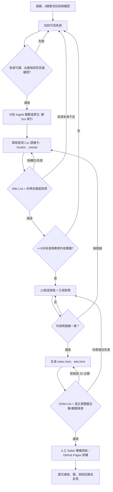

# Loop／Graph 設計與實際執行

> 這份 Graph 為事先規格化流程，實際執行結果詳見 `records/validation-iterations.md`。老師強調：「錯誤應在離源頭最近的地方被發現；小圈修正比最後重跑全程有效率。」

## 1. Graph：來源 → Wiki → 簡報

## 2. Loop：五項規格
| 欄位 | 規則 |
|---|---|
| 目標 | Wiki 至少五份可靠文獻；13 頁可操作 HTML 教學簡報 |
| 限制 | 繁中＋英文術語、逐項 Cxx 出處、不得過度推論、不得上傳 API Key |
| 完成標準 | ≥5 份來源、每頁可追溯引用、12–14 頁、2+ 題測驗、執行驗證與反思紀錄 |
| 停止條件 | 個別修正節點最多 3 輪；來源不足或核心結論無法查證時停並標示不確定 |
| 觸發 | 新增來源、修改 Cxx、產生逐頁稿、修改 HTML |

局部 Loop：`來源 ↔ 證據卡`、`逐頁稿 ↔ 忠實度`、`HTML ↔ 渲染測試`。只有科學內容錯誤才退回上游研究，不能因 CSS 換行問題要求重寫整套 Wiki。

## 3. 本次實作紀錄（有據可查）
- **Batch01**：S01 NIH + S02 Leigh 2022 PDF，已有 13 張證據卡。原紀錄 `records/ingest-batch-01.md`，原 lint 116 pass／0 fail。當時最終門檻因 2/5 及缺 HTML 未達成。
- **Batch02**：加入 S03（2018）、S04（2021）、S05（2025）、S06（2023），共 6 份來源 27 張卡。`records/ingest-batch-02.md` 詳述可查閱範圍。
- **知識前移檢查**：S02/S03 有前後研究系譜，S04 只有摘要，S05 是幼魚 LRE 模型；在來源登錄及證據卡階段已加入限制，避免等 HTML 寫錯先處理。
- **HTML 驗證**：初版在本機 Chromium 截圖發現封面標題孤字換行、iPad 第 8 頁頁尾與內容接近重疊；已改標題換行、平板頁尾設為正常文件流。自訂視窗溢出測試先把裝飾用的 CSS pseudo-element 當成溢出，故修正測試改查真正 document 寬度。詳見 `records/validation-iterations.md`。
- **最終檢查**：`scripts/lint_wiki.py --scope final` 與 `scripts/test_browser.py` 的實際終版輸出列於 records。Safari 實機、遠端公開 URL 尚未驗收，不能聲稱部署成功。

## 4. 反思：哪個節點最容易出錯？
**本次實際執行中最容易出現可見問題的節點是 HTML 渲染／響應式排版（特別是 iPad 尺寸）**：因桌面版固定頁尾可顯示，但 1024px 寬度下第 8 頁內容較長，證據欄靠近內容。另一個風險是研究資料過度推論（S02/S03 關聯、不同配方共同變動），但這是在上游查核時識別的風險，不是虛構的失敗輸出。

**檢查前移改動：**
1. 由最後交件前才看畫面，改成 `HTML 草稿 → 桌面/iPad/手機截圖 → 局部 CSS 修正 → 功能測試`；每次 HTML 改動都跑，而不是等提交才看。
2. 由逐頁稿才發現來源條件不清，改成 `來源登錄 → 研究系譜／可讀範圍 → 證據卡 caveat` 立即檢查，避免把數據混淆帶到教學頁。

**為何修改 Graph：** 流程本身只需小圈快速修正：版面錯誤返回 HTML，不再回到查文獻；來源證據失真則返回對應 Cxx，不會把整份投影片重新寫一遍。這讓修正成本更低，風險更可追溯。

## 5. 目前無法宣稱的項目
- 尚未由獨立第二位審查者完成全部文獻全文科學審核；尤其 S04 只查到 PubMed 摘要。
- 尚未在 iPad 真正 Safari 或 GitHub Pages 公開網址上由使用者操作驗收。
